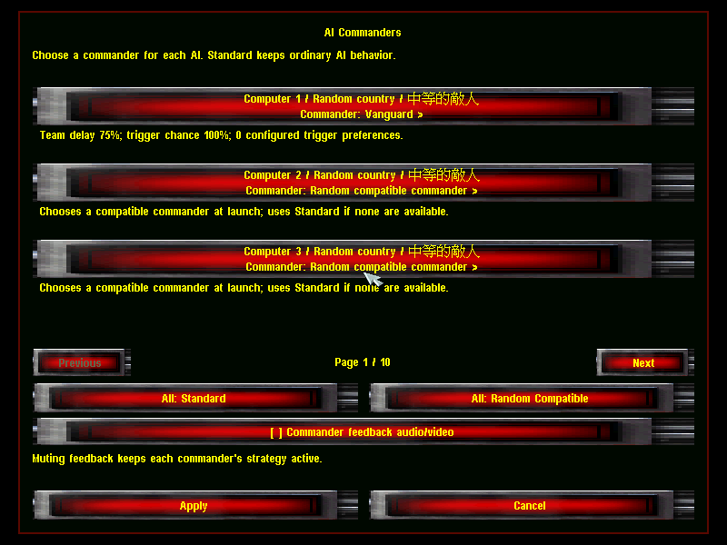
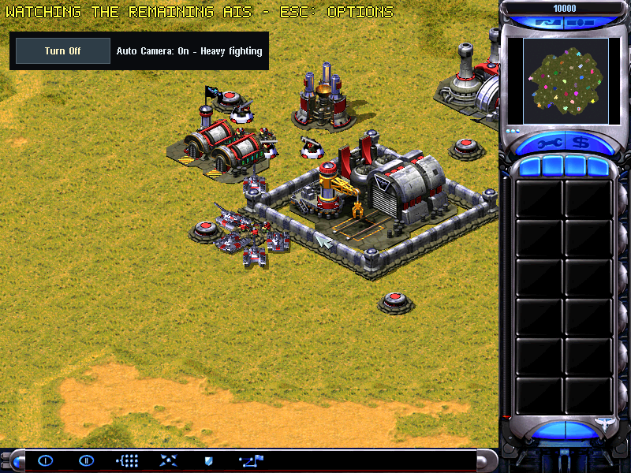
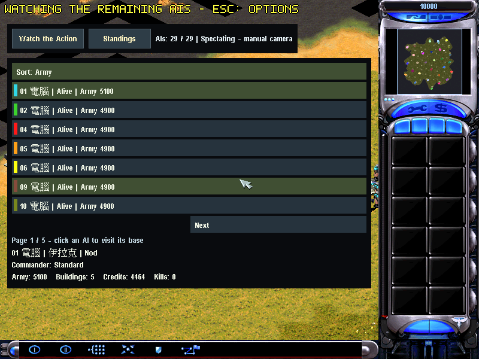
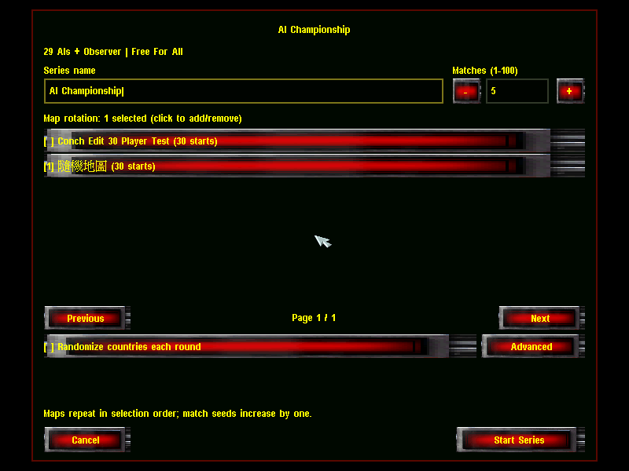
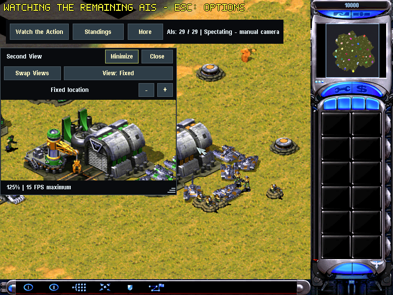
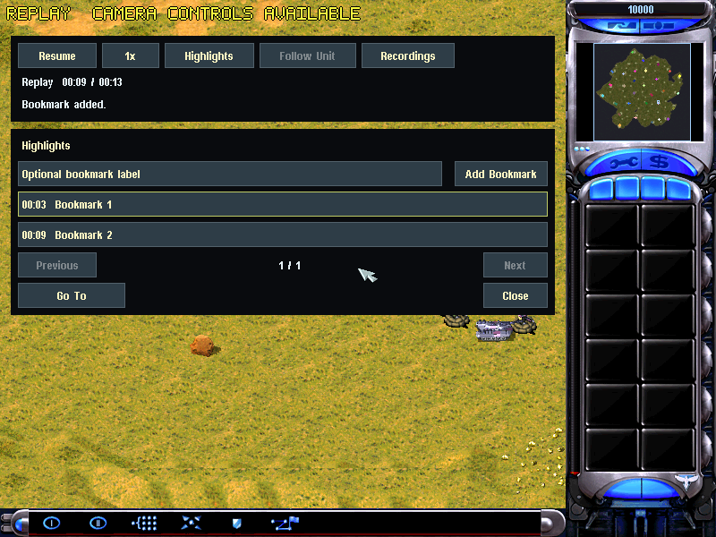
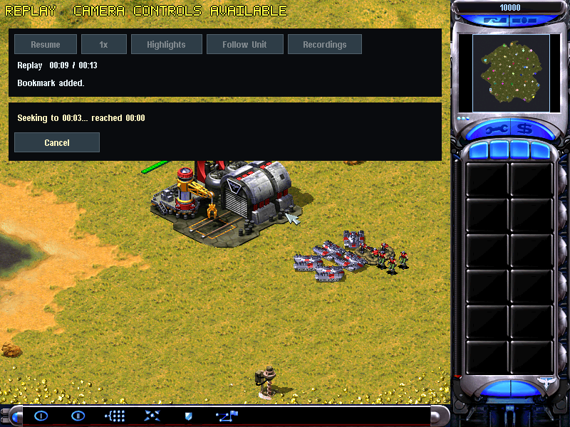
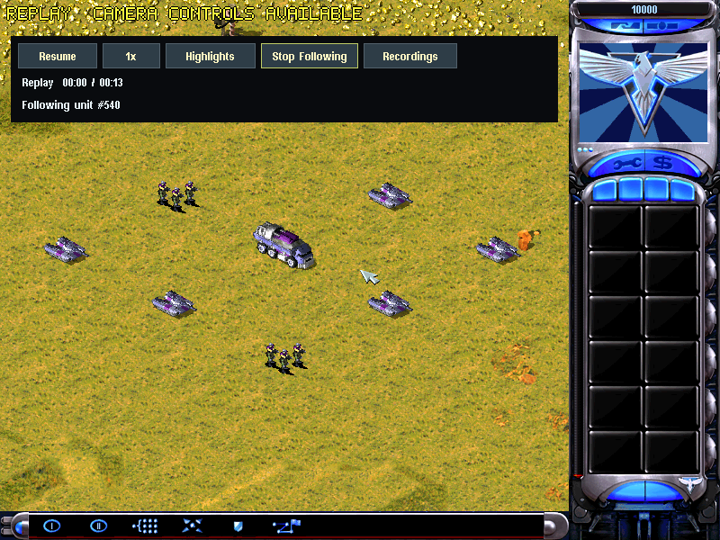

# VERA20k Conch Edit

**重返尤里的复仇，让战场更大，让观战更精彩。** 
**Return to Yuri’s Revenge—with bigger battles and more ways to watch.**

A Rust reimplementation of *Command & Conquer: Red Alert 2 — Yuri’s Revenge*, built on [VERA20K](https://github.com/YuriPlanet/vera20k).

基于 [VERA20K](https://github.com/YuriPlanet/vera20k)，使用 Rust 重新实现《命令与征服：红色警戒 2 — 尤里的复仇》。

[版本与下载 / Version & Downloads](#version) · [致谢与许可 / Credits & License](#license) · [功能展示 / Feature Showcase](#features)

---

## Version & Downloads / 版本与下载

| 项目 / Item | 信息 / Details |
| --- | --- |
| 最新发行版 / Latest release | **[1.1.0](https://github.com/ConchFeng/RedAlert2/releases/tag/v1.1.0)** |
| 发行平台 / Release platform | macOS 11+ · Apple Silicon (M1 or newer / M1 及更新芯片) |
| 引擎版本 / Engine version | **1.1.0** |
| 下载 / Downloads | [仅程序 / App only](https://github.com/ConchFeng/RedAlert2/releases/download/v1.1.0/VERA20k-Conch-Edit-1.1.0-macos-arm64.zip) · [完整包 / Full](https://github.com/ConchFeng/RedAlert2/releases/download/v1.1.0/VERA20k-Conch-Edit-1.1.0-macos-arm64-Full.zip) |
| 文件校验 / Checksums | [App only SHA-256](https://github.com/ConchFeng/RedAlert2/releases/download/v1.1.0/SHA256SUMS.txt) · [Full SHA-256](https://github.com/ConchFeng/RedAlert2/releases/download/v1.1.0/SHA256SUMS-Full.txt) |
| 本页功能 / Features on this page | **[`main`](https://github.com/ConchFeng/RedAlert2/tree/main)** — current source / 当前源码 |

**版本说明：** 1.1.0 统一客户端、引擎与 App 的版本号，包含下方展示的 30 人大战、AI 指挥官、自动观战、实时排行、AI 联赛、双战场视图，以及回放书签、时间跳转与单位跟踪。

**Release note:** Version 1.1.0 aligns the client, engine, and app versions and includes the features below: 30-player battles, AI commanders, automatic battle camera, live standings, AI series, a second battlefield view, replay bookmarks, time seeking, and unit tracking.

## Acknowledgments & License / 致谢与许可

感谢 **Westwood Studios（西木工作室）与 Electronic Arts（EA）** 创造《命令与征服》《红色警戒 2》及《尤里的复仇》，为这份重制工作留下经典的世界、画面、音乐与游戏体验。也感谢 **Halvor Nikolai Rusten、VERA20K 上游项目及所有贡献者** 的持续投入。

With appreciation to **Westwood Studios and Electronic Arts** for *Command & Conquer*, *Red Alert 2*, and *Yuri’s Revenge*—and to **Halvor Nikolai Rusten, the upstream VERA20K project, and all contributors** for making this reimplementation possible.

- **开源许可 / Open-source license:** Engine source is licensed under **[GNU GPLv3](LICENSE-GPL)**. Third-party components retain their [respective licenses](LICENSES). 引擎源码采用 GNU GPLv3，第三方组件保留各自许可。
- **版权 / Copyright:** © 2026 Halvor Nikolai Rusten and VERA20K contributors. Original game artwork and the Command & Conquer / Red Alert trademarks belong to Electronic Arts and their respective rights holders. 原作美术、名称与商标的权利归 EA 及相关权利人所有。
- **游戏资源 / Game resources:** Players must provide the original game resources. The engine’s software license does not license EA’s game assets. 玩家需自行提供原版游戏资源；引擎的开源许可不包含原作素材的授权。
- **独立项目 / Independent project:** This is an unofficial community project, not affiliated with or endorsed by Electronic Arts. 本项目为非官方社区作品，与 EA 无隶属关系，亦未获得 EA 背书。

---

## Feature Showcase / 功能展示

以下均为实际客户端截图。30 人规模指本地遭遇战席位；可以亲自对抗 AI，也可以作为观察者观看 AI 混战。

All images below are actual client screenshots. The 30-player capacity refers to local Skirmish slots: join the battle yourself or watch the AI opponents as an Observer.

### 01 · 30 人大战 / 30-Player Battles

一个战场，最多 **30 个本地席位**：玩家对抗最多 29 个 AI，或由一名全图观察者观看 29 个 AI 自由混战。**Huge / Giant** 随机地图与分页设置，为更多对手留出空间。

Fill up to **30 local slots**: fight as one player against up to 29 AIs, or watch 29 AIs from a full-map Observer seat. **Huge / Giant** random maps and paged opponent settings make larger battles practical to set up.

**入口 / Open:** Single Player → Skirmish → Observer or Player / 单人游戏 → 遭遇战 → 观察者或玩家。

*对手设置可翻页至第 30 个席位。 / Opponent paging reaches the 30th slot.*

### 02 · AI 指挥官 / AI Commanders

为对手选择 **Standard、Random Compatible 或与国家兼容的自定义指挥官**，让不同 AI 拥有可辨认的偏好。策略效果取决于当前规则中的配置；反馈音视频可单独开关。

Choose **Standard, Random Compatible, or compatible custom commanders** for your opponents. Profiles use the current rules’ strategy settings, while a separate switch controls commander audio and video feedback.

**入口 / Open:** Skirmish → AI Commanders… / 遭遇战 → AI 指挥官。

*截图使用自定义指挥官目录；原版规则没有自定义档案时仍可选择 Standard。 / A custom catalog is shown; Standard remains available when the loaded rules provide no custom profiles.*

### 03 · 自动观战 / Automatic Battle Camera

开启 **Watch the Action**，镜头会关注真实交火、基地遇袭与超级武器事件。手动移动或缩放可立即接管镜头，并可随时恢复自动观战。

Turn on **Watch the Action** to follow active combat, base attacks, and superweapon events. Manual navigation or zoom immediately takes control; resume the automatic director whenever you are ready.

**入口 / Open:** Offline Observer → Watch the Action / 离线观察者 → Watch the Action。

*自动镜头跟随战场变化，也始终允许手动接管。 / Follow the action while retaining manual camera control.*

### 04 · 实时排行 / Live AI Standings

随时查看 **存活 AI、军队价值、建筑数、资金与击杀数**。支持排序和分页，点击条目即可前往该 AI 的基地或幸存单位。

See **surviving AIs, army value, buildings, credits, and kills** as the match unfolds. Sort and page through the entrants, then click an AI to visit its base or surviving units.

**入口 / Open:** Offline Observer → Standings / 离线观察者 → Standings。

*29 个 AI 分页展示；详细数据与战场位置相互关联。 / Paged standings connect all 29 AIs with their current battlefield positions.*

### 05 · AI 联赛 / AI Leagues

安排 **1–100 场本地 AI 系列赛**，选择地图轮换与随机种子策略，自动衔接下一场。比赛结果记录胜、平、负；支持暂停、结束与恢复未完成的系列赛。

Schedule **1–100 local AI matches** with map rotation and seed settings. Automatic rematches and persistent standings track wins, draws, and losses, with controls to pause, end, or recover a series.

**入口 / Open:** Skirmish → Observer + Free For All → AI Series… / 遭遇战 → 观察者 + 自由混战 → AI Series。

*本地系列赛设置：选定参赛者、场次与轮换地图。 / Configure the entrants, match count, and map rotation for a local series.*

### 06 · 双战场视图 / Dual Battlefield Views

通过一个可拖动、缩放和最小化的悬浮视图，同时观察两处战线。副视图拥有独立镜头与缩放，可固定位置、跟随玩家或关注战斗，并支持 **Swap Views** 交换主副视角。

Watch two fronts with a floating panel that can be moved, resized, or minimized. Its independent camera can hold a location, follow a player, or follow the action. **Swap Views** exchanges the main and secondary viewpoints.

**入口 / Open:** Offline Observer → More → Second View / 离线观察者 → More → Second View。

*一个窗口观察两处战场，主副镜头可独立调整。 / Two battlefield locations in one window, with independent camera control.*

### 07 · 回放书签 / Replay Bookmarks

在 **Highlights** 中为关键时刻添加时间书签与可选标签，同时保存镜头位置、缩放和跟踪目标。书签与具体录像绑定，重新打开录像后仍可使用。

Save important moments in **Highlights** with timestamps and optional labels. Bookmarks retain the camera position, zoom, and optional tracked unit, and remain associated with the recording when you reopen it.

**入口 / Open:** Replay → Highlights → Add Bookmark / 回放 → Highlights → Add Bookmark。

*用时间与标签整理值得重看的战场片段。 / Organize the moments you want to revisit by time and label.*

### 08 · 时间跳转 / Replay Seeking

选择书签并点击 **Go To**，回放会真正前进或返回对应时间点。跳转过程显示进度并可取消；取消后保留原位置。另有 **暂停 / 继续与 1×、2×、4×** 播放速度。

Select a bookmark and choose **Go To** to move forward or backward to that point in the recording. Seeking shows progress and supports cancellation without losing your original position. **Pause / Resume and 1×, 2×, 4×** playback are also available.

**入口 / Open:** Replay → Highlights → Select a bookmark → Go To / 回放 → Highlights → 选择书签 → Go To。

*跳转改变回放时间，而不只是移动镜头。 / Seeking changes the recording’s time as well as its viewpoint.*

### 09 · 单位跟踪 / Unit Tracking

在回放中点击可见单位，选择 **Follow Unit**，镜头即可持续跟随。单位被摧毁、移除或不再可用时，跟踪会自动解除并提示；整个过程只用于观看。

Click a visible unit during playback and choose **Follow Unit** to keep the camera with it. Tracking releases with a clear message when the unit is destroyed, detached, or unavailable. Replay selection and tracking remain read-only.

**入口 / Open:** Replay → Click a unit → Follow Unit / 回放 → 点击单位 → Follow Unit。

*跟随一个单位，观察它在战局中的行动。 / Stay with one unit and follow its role in the battle.*
