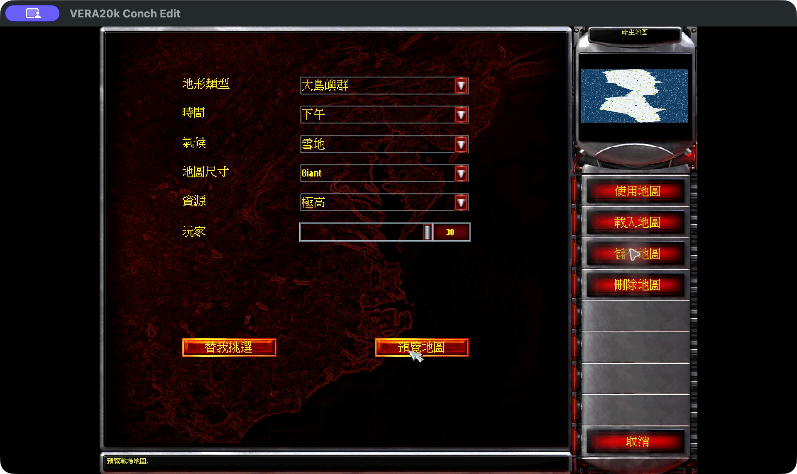
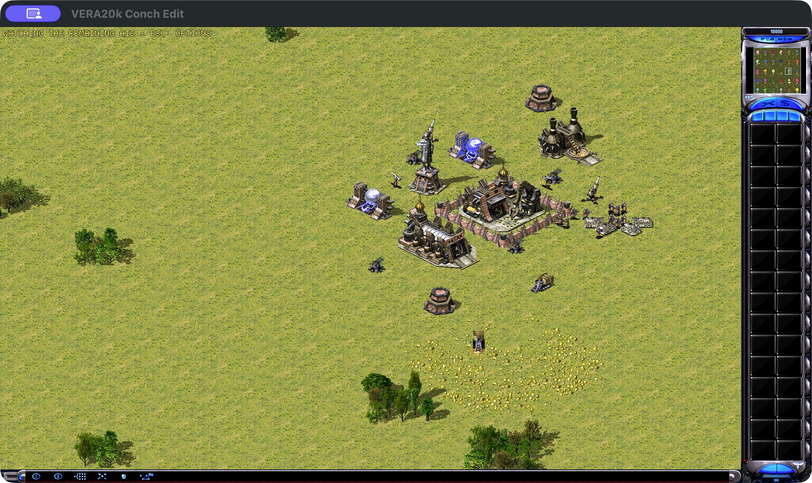
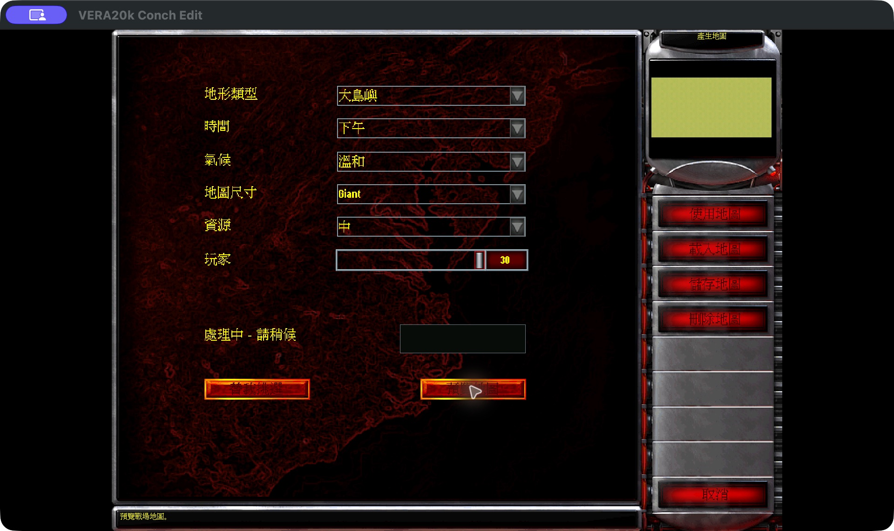
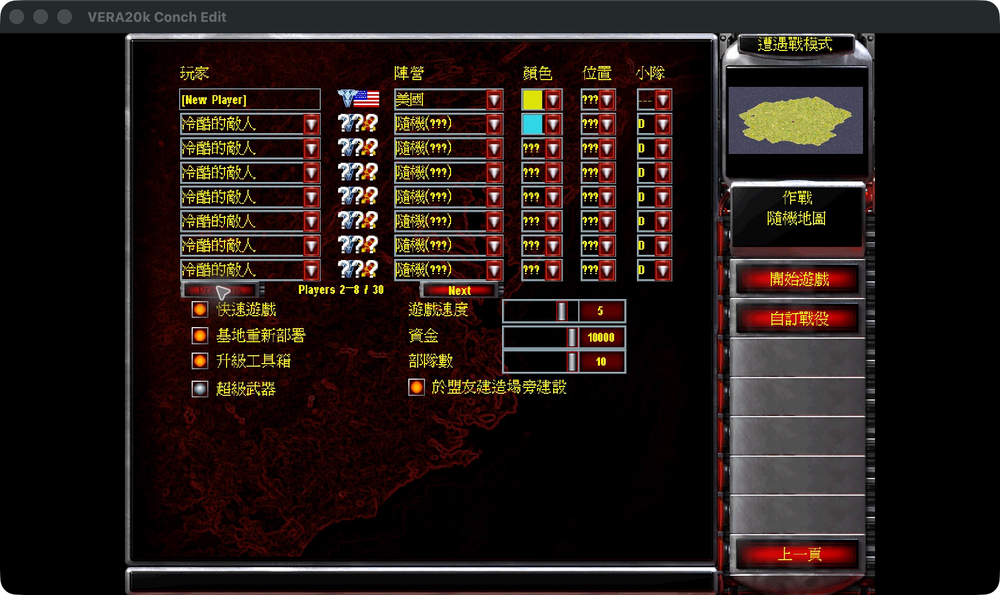
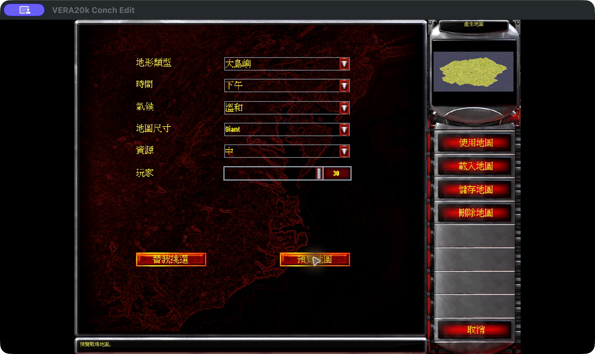
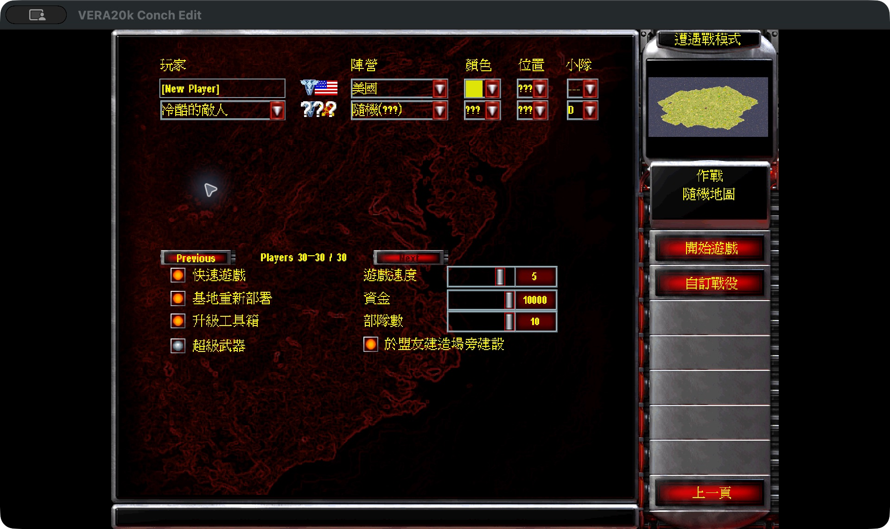
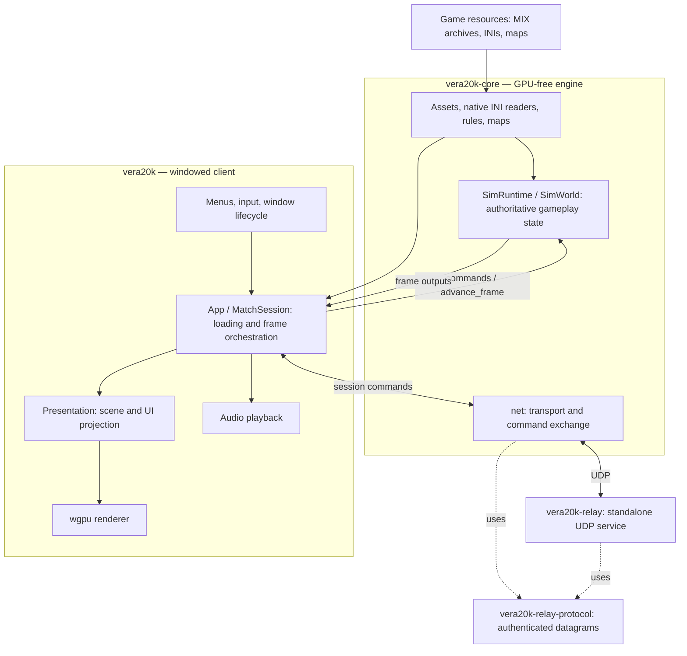

<p align="center" dir="ltr">
  <a href="https://github.com/ConchFeng/RedAlert2/actions/workflows/macos.yml?query=branch%3Amain" title="Latest macOS library test run (run manually)"></a>
  <a href="https://github.com/ConchFeng/RedAlert2/actions/workflows/linux.yml?query=branch%3Amain" title="Latest Linux library test run (run manually)"></a>
  <a href="https://github.com/ConchFeng/RedAlert2/actions/workflows/windows.yml?query=branch%3Amain" title="Latest Windows library test run (run manually)"></a>
  <a href="https://discord.gg/kmjRUn5m5F"></a>
  
</p>

# VERA20k Conch Edit

**Red Alert 2: Yuri's Revenge rebuilt in Rust, with local skirmishes for up to 30 players.**

ConchFeng's edition of [VERA20K](https://github.com/YuriPlanet/vera20k) expands the
original eight-player setup to **30 local player slots**: fight **29 AI opponents**
yourself, or watch **29 AIs battle from a full-map Observer view**. **Huge and Giant
random maps** provide room for larger battles while keeping the original game's
assets and atmosphere. The current downloadable packages target **macOS on Apple Silicon**.

[Download 1.0.1](#download-and-play) · [30-player battles and AI spectating](#30-player-battles-and-ai-spectating) ·
[30-player walkthrough](docs/30-player-showcase.md) ·
[Architecture](#architecture) · [Developer documentation](docs/index.md)



*Giant is the largest random-map option. These are actual application captures
using the supplied Chinese game localization.*

## 30-player battles and AI spectating

**Play against 29 AIs, or let the AIs fight while you watch.** Local Skirmish
supports 30 setup slots with two ways to enjoy a large battle:

| Mode | Setup | Your role |
| --- | --- | --- |
| Play the battle | 1 human player + up to 29 AI opponents | Build your base, command your army, and fight the computers. |
| Watch the AIs | 1 Observer + up to 29 AI players | Follow the AI battle with full-map visibility and no army of your own. |

A fresh offline Skirmish defaults to **Observer + 29 Normal AIs in Free For All**.
The AIs develop their bases, gather resources, and fight each other while you
watch. Your explicit role and settings choices are remembered; choose Player
in Skirmish setup when you want to join the fighting. The Observer does not occupy
a map starting position.



*Actual gameplay capture: an AI base and its units during an ongoing spectator
session. The top-left message, “WATCHING THE REMAINING AIS — ESC: OPTIONS,”
identifies the spectator view; the minimap shows the different player colors.*

To set up a large match, open **Single Player → Skirmish**, choose Observer or
Player, and check the AI rows with **Previous** and **Next**. Use a map with enough
starting positions. If the selected map is too small, the game opens the
**30-player Giant random-map setup**: **Generate Map → Use Map → Start Game**.
AI difficulty remains adjustable.

If you play and are eliminated, the offline match continues while
hostile AI survivors remain, so you can watch the remaining computers fight.
Press **Esc** for options. At the end, the results screen stays open:
**View Battlefield** shows the paused final battlefield, **Esc** returns to the
results, **Play Again** starts the same setup with a new seed, and **Return to
Menu** leaves the match.

## What's new in Conch Edit

- **30-player local skirmish setup:** enable up to 29 computer opponents and
  page through their settings with **Previous** and **Next**.
- **Larger random maps:** **Huge** and **Giant** expand beyond the retail sizes;
  dimensions also grow with the selected player count, within the generator's cap.
- **More player colors:** 22 additional colors become available on maps with
  more than eight player slots.
- **Saved extended setups:** opponent settings past the original seven are
  retained in `VERA.INI`.
- **Startup settings and recovery:** configure window dimensions, including
  1920 × 1080 physical pixels, and use **Choose Folder** when game resources
  cannot load.

## 30-player showcase

The captured flow uses **Giant**, **30 players**, and all **29 computer opponents**
enabled. Selecting 30 in the generator creates the map capacity; enable the
opponents separately before starting the match.

| Generate the largest map | Configure the opponents |
| --- | --- |
|  |  |
|  |  |

See the [full screenshot walkthrough](docs/30-player-showcase.md) for the generated
preview, additional opponent pages, extended colors, and the current runtime limit.

## Project goals

1. Keep the gameplay, visuals and atmosphere of the original Red Alert 2: Yuri's Revenge.
2. Support bigger battles: up to **30 players** and **20,000 units** on 500×500 maps.
3. Incorporate known RTS features and some never seen before.
4. Integrated multiplayer client

## Current status

**In active development.**

- **Skirmish:** Playable on Windows, Linux and macOS, with original and random maps,
  base building, harvesting, combat and save/load.
- **Campaigns:** Missions can launch; support remains incomplete.
- **AI:** Parts of the original AI handle base building and scripted attacks.
- **Ongoing work:** Gameplay accuracy, visuals and performance.
- **Multiplayer:** LAN and online play are available in current source builds on
  macOS and Linux.
- **Large-map limit:** The captured Giant/30-player map generates and reaches
  Skirmish setup. Its earlier pathfinding zone-builder stack overflow is fixed,
  but a live match of that setup has not been captured; generation screenshots
  do not establish a completed match.
- **Scale:** 20,000 units remains a project target. Long-game stability and
  smooth performance at maximum map size and player count require further validation.

## Download and play

The [1.0.1 release](https://github.com/ConchFeng/RedAlert2/releases/tag/v1.0.1)
provides two ZIP downloads for **Apple Silicon Macs (M1 or newer), macOS 11.0 or later**:

| Package | Size | Contents |
| --- | --- | --- |
| [macOS Full ZIP](https://github.com/ConchFeng/RedAlert2/releases/download/v1.0.1/VERA20k-Conch-Edit-1.0.1-macos-arm64-Full.zip) | 418.60 MB | App, supplied Yuri resource files, maps, audio, and bilingual instructions. |
| [macOS app ZIP](https://github.com/ConchFeng/RedAlert2/releases/download/v1.0.1/VERA20k-Conch-Edit-1.0.1-macos-arm64.zip) | 19.03 MB | App and instructions; provide your own Yuri's Revenge resources. |

1. Extract the entire ZIP and open `VERA20K.app` from your preferred folder.
2. Choose the game-resource folder when prompted. For the Full package, select
   its `assets/` folder or the parent folder containing it.
3. Open **Single Player → Skirmish → Choose Map → Create Random Map**, select
   **Giant** and **30 players**, generate the map, and choose **Use Map**.
4. Choose **Observer** to watch the AIs, or **Player** to fight them. Check up to
   **29 AI opponents** across the setup pages, then choose **Start Game**. See
   [30-player battles and AI spectating](#30-player-battles-and-ai-spectating)
   and the [map walkthrough](docs/30-player-showcase.md) for details.

The ZIPs contain native ARM64 macOS executables; Intel Mac, Windows, and Linux
binaries are not included. The source remains cross-platform. The release/app
bundle version is `1.0.1`; the internal engine version is `0.2.4`.

The app is signed ad hoc and is not Apple-notarized. If macOS blocks its first
launch, review the source and use **System Settings → Privacy & Security →
Open Anyway**. Allow access to your selected game-resource folder when prompted.
Configuration, saves, logs, and replays normally live in
`~/Library/Application Support/VERA20k/`; existing custom paths remain in effect.
Checksums and bilingual instructions are included on the release page.

Use **Options** for sound and controls, and **Vera Options** for VERA-specific features.

To launch single-player YR skirmishes or campaigns from a CnCNet client, see the
[offline client setup](integrations/cncnet/README.md).

## Contributing

Help is welcome. You can write code, refactor the engine, test the game, share ideas, or play
it next to the original and tell us what feels wrong. Open a PR and we'll take it from there.

Contributors can take responsibility for engine areas, with broad freedom to make changes that
move VERA20k Conch Edit forward.

Maintainers will help with review, integration and merging. You'll keep full credit for your
contribution.

Discussion is on [Discord](https://discord.gg/kmjRUn5m5F) and in the QQ group (1097193563).

## Architecture

The workspace has four crates. The windowed client uses a GPU-free core;
the standalone relay and its shared protocol remain separate crates.



Solid arrows show runtime data flow; dashed arrows show use of the shared
protocol crate. Simulation owns gameplay, RNG, and frame updates. It does not
depend on rendering, UI, audio, or networking. Presentation derives its output
from simulation state. See the [project guide](docs/project-guide.md) for source
owners and entry points.

## Build and run

An opt-in [WebAssembly single-player preview](docs/wasm.md) is also available.
It uses a separate build command; desktop builds keep their existing defaults.

You need:

- **Rust and Git:** [Rust](https://rustup.rs/) 1.97 or later, installed with rustup, and
  [Git](https://git-scm.com/).
- **Build tools:** on Windows, the Visual Studio C++ build tools, which the Rust installer offers
  to install; on macOS, `xcode-select --install`; on Debian and Ubuntu,
  `sudo apt install build-essential libasound2-dev libxkbcommon-x11-0 pkg-config`.

VERA20k Conch Edit has been played on Windows, Linux and macOS.

```sh
git clone https://github.com/ConchFeng/RedAlert2.git
cd RedAlert2
cp config.toml.example config.toml
# Edit config.toml and set ra2_dir to your game folder before running:
cargo run --release --bin vera20k
```

### Large maps

Desktop builds support map `Size` width + height up to 1024 without a feature flag.
A map whose sum is at most 512 keeps retail 512-stride cell addressing; larger
maps automatically select 1024-stride addressing. This is a bounded VERA extension.
Generate a literal 500×500 map with 30 starts using
`python -m tools.scale_map large500.map --size 500 --starts 30`.
A map whose `[Basic] MaxPlayers` names 9–30 authored starts seats that many players
in Skirmish: **Previous** and **Next** page the computer opponents seven at a time,
and players past the eighth choose from 22 extra colors.
Retail overlay packs keep their 512×512 layout; extended packs use 1024×1024.
Both map sizes use the same executable and versioned save machinery. Stored-layout
changes are checked by the existing snapshot version guard; this change does not
provide a migration for saves from the earlier 16-bit navigation layout.
Basic loading, movement and MCV deployment are checked separately from 30-player,
long-game and large-unit-count performance, which remain unvalidated.

## How we work

Most of the code is written by AI coding agents. They use Ghidra to study the original
engine, then port its behavior to Rust and check it with [comparison tools](tools/native_oracle.md)
and playtesting. Agents follow [AGENTS.md](AGENTS.md).

## Customization

VERA20k Conch Edit plays like the original game by default. Map capacity is selected automatically as
described above. Other new features, including extensions from mods such as Ares, stay off
until they are turned on with one of:

- **A VERA player option**, in **Options → Vera Options**, saved under `[VERA]` in `VERA.INI`.
- **A build option**, such as `--features ares` for the supported [Ares extensions](docs/ares.md).
- **An INI key**, set by a mod or a map.

Sound, graphics and controls are saved in `VERA.INI`. Gameplay rules come from lobby
settings, mods or maps.

## Upstream project support

These links support the upstream VERA20K project.

<a href="https://paypal.me/vera20k"></a>

All donations received are distributed
to contributors according to the [TIBTRE contribution ledger](https://github.com/YuriPlanet/tibtre-ledger).

Payouts to contributors:

<p>     </p>

## Credits and legal

Thanks to OpenRA, XCC Mixer, the ModEnc wiki, Project Perfect Mod, EA's GPL source release of
Command & Conquer and Red Alert, World-Altering Editor, Final Alert, YRpp, Ares, Phobos and
many others.

Copyright © 2026 Halvor Nikolai Rusten and VERA20K contributors.
Licensed under the [GPLv3](LICENSE-GPL). This repository contains no game files. Command &
Conquer and Red Alert are trademarks of Electronic Arts Inc., and the screenshots and the app
icon, Red Alert 2's red star, show game art owned by Electronic Arts. VERA20k Conch Edit is not
affiliated with or endorsed by Electronic Arts.

## Documentation

- [Build and run](#build-and-run): requirements and building from source.
- [30-player screenshot walkthrough](docs/30-player-showcase.md): Giant map generation, opponent pages, and runtime status.
- [Large skirmish and random maps](docs/large-skirmish.md): implementation owners, sizing rules, and limitations.
- [INI profiles](docs/ini-roots.md): choosing rules, art and AI files.
- [Ares](docs/ares.md), [Phobos](docs/phobos.md), [NPatch](docs/npatch.md) and [VeraX](docs/verax.md): extension support and limitations.
- [Documentation and agent index](docs/index.md): starting points, owner guides and collaboration links.
- [Project guide](docs/project-guide.md): code layout, production flow and authoritative state owners.
- [Developer tools](tools/README.md): builds, tests and asset inspection.
- [Map testing](tools/map_observation.md): scripted scenarios, screenshots and match observations.
- [Native comparisons](tools/native_oracle.md): comparing behavior with the original game.
- [Ghidra workflow](docs/ghidra-workflow.md): inspecting the original engine.
