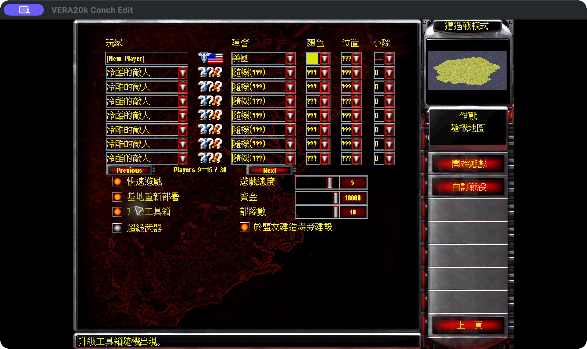
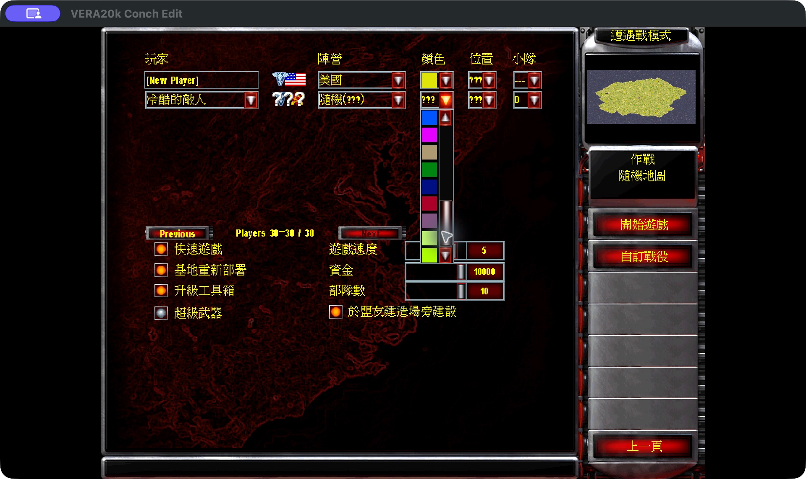

# Giant random maps and 30-player skirmishes

These screenshots were captured from the current macOS app on October 31, 2026,
at a 1920 × 1080 client resolution. The game uses the supplied Chinese
localization. The demonstration selects **Giant**, the largest random-map option,
and **30 players**, then enables **one human and 29 computer opponents**.

The [README](../README.md#download-and-play) links to the macOS downloads.
[Large skirmish and random maps](large-skirmish.md) describes the code owners
and exact sizing rules.

## 1. Select Giant and 30 players

Open **Single Player → Skirmish → Choose Map → Create Random Map**.
Set **Map Size** to **Giant** and move **Players** to **30**. The illustrated
setup keeps the large-island terrain, afternoon lighting, temperate climate,
and medium resources.

## 2. Generate the map

Choose **Generate Map**. The controls disable while the production generator
builds the terrain and starting positions; the progress screen below is an
actual capture during that operation.

## 3. Inspect the finished preview

The preview appears when generation finishes. **Use Map** becomes available,
and the settings still show **Giant** and **30**.

## 4. Enable the computer opponents

Choose **Use Map** to return to Skirmish. A 30-player map makes 30 slots
available; it does not automatically enable 29 opponents. Set each required
opponent to an AI difficulty. This demonstration enables all 29 at Hard.

The local player stays at the top. **Previous** and **Next** page through seven
opponents at a time. The first page shows **Players 2–8 / 30**.

The following capture shows **Players 9–15 / 30** enabled.

The final page reaches **Players 30–30 / 30**, with the last computer enabled.

## 5. Choose extended colors

Maps with more than eight player slots offer 22 additional colors. Scroll the
color list to reach the later choices; these extend the original eight colors.

## Current gameplay limitation

This specific Giant/30-player map generated successfully and reached the
completed opponent setup. Starting it on macOS first overflowed the stack in
`sim::pathfinding::zone_build::flood_fill_node_index` while constructing pathfinding
zones; the fill now uses an explicit stack. No live match of this setup has been
captured since, so no live-match screenshot is presented as a result.

The captures demonstrate the actual settings, generation, preview, colors,
and opponent paging. They do not establish long-game stability, maximum-scale
performance, or 30-human online play. Network random-map setup retains its
eight-player limit.
